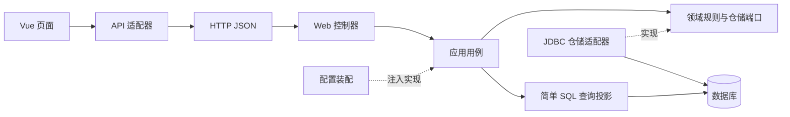

# 02 · 架构与模块边界

## 架构目标

项目的核心目标是让学习者能够解释复杂业务，而不只是调用框架。业务规则尽量集中、依赖尽量明确、变化影响范围尽量可预测。

后端是按业务组织的模块化单体：所有模块在一个 Spring Boot 进程、一个数据库中运行。前端是独立 Vue 工程，通过 HTTP JSON 接口交互。这里的“模块”是源码包边界，并不是多个 Maven 子工程，也不是多个独立服务。

## 先按业务，再按职责

传统目录把所有 Controller、Service、DAO 分别堆在一个大文件夹。功能变多后，修改客户业务要穿过多个庞大的目录。本项目先按 identity、customer、account、transfer 等业务组织，再在需要的模块内划分 domain、application、infrastructure、web。

并非每个模块都必须有四个空目录。只有实际需要独立变化的职责才拆分。产品与贷款当前使用应用服务编排 SQL，客户和账户则展示仓储接口与适配器的完整结构。

### Web 层

负责 URL、HTTP 方法、请求 DTO、参数校验、统一响应。CustomerController 把 HTTP 请求翻译为用例调用；它不应该计算手续费、执行 SQL、修改余额。

控制器通常可以很短。短不是追求本身，而是业务复杂度已经放到了更合适的位置。

### Application 层

负责一个业务动作的编排。例如 TransferService 取得当前员工、进入幂等事务、选择费用策略、锁定账户、执行规则、调用记账入口、保存订单并发布事件。

它可以依赖 Spring 的服务、事务和事件抽象。应用服务通常不适合做成“万能 BaseService”：不同业务的规则、权限、事务边界并不相同。

### Domain 层

负责稳定的业务语义。例如 Money 拒绝分以下精度，AccountStatus 管理状态迁移，FeePolicy 描述费用算法，RepaymentCalculator 维护计划计算骨架。

领域类不依赖 Spring、Web、JDBC 或应用层。ArchitectureTest 会检查这一点，因此它们可以直接 new 出来做快速单元测试。

### Infrastructure 层

负责具体存储技术。JdbcCustomerRepository 实现 CustomerRepository，JdbcAccountRepository 实现 AccountRepository，SessionRepository 实现 SessionStore。

领域端口只声明能力，如 find、lock、create；JDBC 实现处理表名、参数、行映射。替换为其他持久化实现时，领域模型无需知道新技术。

## 实际模块协作

| 发起方 | 依赖的能力 | 原因 |
| --- | --- | --- |
| 账户应用服务 | 客户查询 | 开户前确认客户存在 |
| 转账应用服务 | 记账服务、费用策略、规则、幂等 | 协调一次资金转移 |
| 产品应用服务 | 客户查询、记账、幂等 | 适配风险并完成申购扣款 |
| 贷款应用服务 | 账户查询、记账、计划算法 | 放款与状态、计划同步提交 |
| 记账服务 | 账户仓储端口 | 统一获取行锁和更新余额 |
| 通知模块 | BusinessCompleted 事件 | 发布方无需依赖通知保存逻辑 |

跨模块调用以明确的应用能力或领域端口为边界。不要从一个控制器直接调用另一个控制器；控制器是协议适配器，不是可复用的业务接口。

## 高内聚如何体现

手续费公式留在手续费策略，金额精度留在 Money，账户余额变化规则留在 Account，统一写账留在 PostingService，HTTP 头处理留在 http.ts。相关变化集中，修改时容易找到正确位置。

如果“冻结账户不能转账”的判断在五个页面、三个控制器和两个 SQL 中重复，就算类文件很多，也不代表内聚良好。

## 低耦合如何体现

构造器显式声明依赖；领域不引用框架；仓储由端口定义；手续费算法以接口替换；通知使用事件；前端组件使用统一 API 适配器。每一种方式都针对一个真实变化点。

低耦合不意味着完全没有依赖。转账必须依赖账户能力，否则无法转账。关键是依赖是否符合业务方向、是否稳定、是否容易被解释。

## 为什么查询仍有 SQL

报表、流水和列表查询直接通过应用层 JDBC 投影生成响应，不强制经过仓储接口与聚合对象。这样减少一层没有独立价值的搬运代码，适合展示读写职责分离的入门形式。

本项目不是严格的完整六边形架构实现：部分事务编排仍使用 JDBC、应用服务之间仍有直接依赖，事件类型位于通知模块的领域包。后续可将事件移入独立 contracts 包，把复杂写入提取为端口。文档不把这些取舍包装成已经实现的隔离。

## 一个判断练习

需求“即时转账手续费最高 30 元”：修改 InstantFeePolicy 和对应测试即可。需求“增加转账渠道”：增加枚举、策略、装配与前端选项。需求“更换数据库”：重点检查 SQL 方言、驱动、迁移与并发测试。需求“页面改色”：不应修改业务规则。

每次修改前，先写一句“这条规则由谁拥有”。这句话往往比先画大量类图更有帮助。
