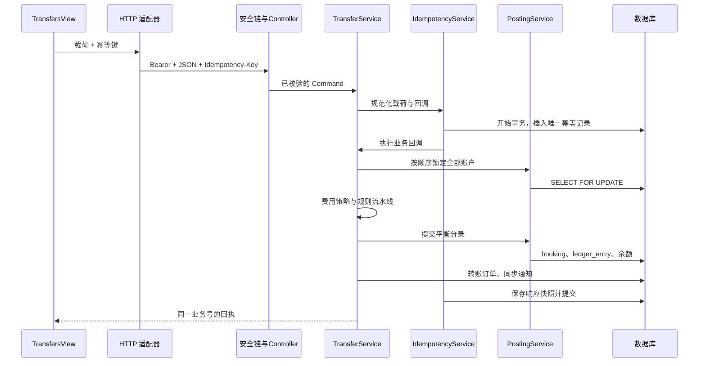

# 03 · 一笔转账的全链路

以 A1001 向 A1002 即时转账 100 元为例，目标结果是 A1001 减少 101 元、A1002 增加 100 元、内部手续费账户增加 1 元，只产生一笔业务订单。

## 先建立调用地图

## 第一步：表单只维护输入

打开 `frontend/src/views/TransfersView.vue`。form 是一个 reactive 对象，amount 保持字符串，不做 JavaScript 浮点加减。MoneyInput 提供输入模式和原生格式约束，但真正的金额规则仍由服务端执行。

提交时通过 `{ ...form }` 创建快照，避免正在执行的请求与用户继续编辑表单共享可变引用。useCommand 控制 pending、防止同一页面重复点击，并统一显示错误。

前端按钮禁用只改善交互。用户可以直接发 HTTP 请求，也可能打开多个标签页，因此服务端仍必须独立处理重复请求。

## 第二步：幂等键代表一次业务意图

createIdempotentExecutor 为当前载荷生成 UUID 键。请求失败时保留该键，同样载荷重试继续使用；成功后清空；载荷改变则生成新键。

这是一个页面生命周期内的重试策略。刷新页面或重新打开弹窗后，内存中的键可能丢失。因此网络结果不确定时应先查询业务记录，再决定是否新建一笔；跨页面持久化业务草稿是后续练习。

## 第三步：HTTP 适配器处理协议

`api/bank.ts` 定义 transfer 函数，`api/http.ts` 统一添加 Authorization、Content-Type 和 Idempotency-Key，设置超时、解包 ApiResponse，并把业务错误保留为 ApiError。

为什么拆两个文件？bank.ts 理解“转账是什么”，http.ts 理解“如何发送 HTTP”。改变响应信封不需要修改所有页面；改变转账路径不需要修改通用请求器。

## 第四步：先认证，再授权，再执行业务

TraceFilter 为请求创建追踪号。BearerTokenFilter 将令牌哈希后查询有效会话，生成包含权限的认证对象。Spring Security 拒绝未登录请求。

TransferController 接收 @Valid DTO，将其转换为 Command。TransferService.transfer 上的 @PreAuthorize 要求 transfer:write。auditor 即使绕过页面手工提交，也会收到 403。

DTO 处理长度、非空、格式；领域和值对象处理业务语义。两者重复检查部分规则是有意的：HTTP 入口不能成为领域模型唯一的保护。

## 第五步：在独立事务中占用幂等键

IdempotencyService 使用 TransactionTemplate 开始事务，先插入 `(scope, request_key)` 唯一记录。scope 包含用例和员工 ID，防止不同员工的键互相复用。

若同键已提交，插入会冲突；失败事务退出后，再读取已有响应。请求指纹相同则返回原回执，不再执行扣款；指纹不同则返回 IDEMPOTENCY_CONFLICT。

指纹是规范化请求 JSON 的 SHA-256。金额 100 和 100.00 会先转换为同样的两位小数。备注仍参与指纹：同一个键不能偷偷改为另一笔有不同备注的业务。

为什么不在失败事务内部查询？PostgreSQL 的唯一键冲突会使当前事务进入中止状态，继续查询也无法正常工作。代码在事务外捕获 DuplicateKeyException，就是为避免这个常见错误。

## 第六步：获取账户行锁

即时转账涉及源账户、目标账户、SYS-FEE。PostingService.lockAccounts 先去重、排序，再依次执行 SELECT FOR UPDATE。

源账户锁让余额与日累计限额的检查串行执行。两个线程不能同时依据同一份旧余额完成扣款。所有调用按相同顺序锁定账户，可减少 A→B 与 B→A 造成的循环等待。

排序只能降低账户锁顺序导致的死锁，不能保证整个系统永不死锁。跨产品行、贷款行和账户行的新增事务仍需分析全局锁顺序。

## 第七步：执行规则与算法

FeePolicyRegistry 根据渠道选择算法：标准免费；即时按 0.1% 计算，最低 1 元、最高 20 元，HALF_UP 到分。

规则按装配顺序执行：检查普通客户账户、账户不同、状态正常、余额足够支付本金与手续费，再检查单笔 20,000 元和每日 50,000 元限额。

日累计以 Asia/Shanghai 当天零点为起点，只统计已成功提交的转账本金，不统计手续费。这是明确的教学业务口径；修改口径时要同时修改规则与测试。

## 第八步：写入平衡分录

本次分录为：

| 账户 | 余额变动 |
| --- | ---: |
| A1001 | -101.00 |
| A1002 | +100.00 |
| SYS-FEE | +1.00 |
| 合计 | 0.00 |

PostingService 验证分录至少两项、金额和为零、账户不重复、变动不为零，预先计算每个账户的新余额，再写 booking、余额快照和 ledger_entry。

这里实现的是教学用的“余额增减平衡模型”，没有完整会计科目、借贷方向、币种、总账与分户账系统。不要把求和为零等同于完整银行会计。

## 第九步：订单、通知和响应一起提交

TransferService 保存订单，发布 BusinessCompleted。NotificationService 的 @EventListener 同步执行并写数据库，参与当前事务。

IdempotencyService 保存回执 JSON，事务提交。若中间任意一项失败，幂等占位、余额、分录、订单和通知一起回滚。测试用事件监听器在记账后抛异常，专门验证了这个性质。

AuditAspect 在业务提交并成功返回后尝试记录操作名、员工与追踪号。它是独立的最佳努力操作审计；它不属于资金原子提交的一部分，也不保证失败调用被记录。

## 第十步：页面展示结果

收到回执后，页面展示业务号、金额和手续费，刷新记录与账户选项。页面本身不推测新余额，而是重新查询后端结果。

## 带着问题再读一次

如果扣款成功但网络断开，前端知道成功了吗？为什么要保存完整响应？如果目标账户被冻结，在哪一层拒绝？如果通知监听器抛异常，哪个事务回滚？如果把 @EventListener 改成异步，当前原子性还存在吗？

建议先独立回答，再对照第 05、06、08 章与实际测试。
