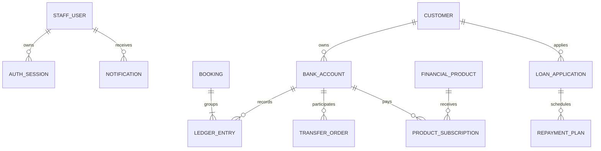

# 06 · 数据库与资金一致性

## 表与业务的关系



迁移脚本 `V1__schema.sql` 是表结构的真实来源。Flyway 在启动时检查并执行，历史文件一旦使用后应保持不变；新结构使用 V2、V3 等新迁移。

## 三种数据角色

业务单据描述“发生了什么”：transfer_order、loan_application、product_subscription。

booking 和 ledger_entry 描述“资金如何变化”。每个 booking 使用唯一 business_key，防止同一业务重复记账；分录的账户组合与金额维护平衡约束。

bank_account.balance 是便于查询的余额快照。它必须与所有历史分录之和一致，不能用管理员随意编辑余额的方式修改。本项目演示期初余额同样经过 PostingService。

## 金额的三道边界

HTTP 使用字符串，如 "100.01"。MoneyAmount 校验输入，拒绝第三位小数。Java 使用 BigDecimal 与 Money 值对象。数据库使用 DECIMAL(18,2)，普通客户账户还有余额非负约束。

Money 不接受隐式舍入，例如 1.001 不能悄悄变成 1.00。手续费和贷款利息涉及计算结果时，算法明确使用 HALF_UP，业务输入与算法舍入是两个不同问题。

JSON 响应通过 JsonConfiguration 把 BigDecimal 序列化为字符串。前端展示金额直接做字符串分组，不让 Number 参与资金运算。产品年化百分比转成 Number 只用于页面展示，不用于结算。

## 事务保护哪些写入

转账的幂等占位、记账组、余额、分录、订单、同步通知、响应快照，在同一个数据库事务中提交。

贷款放款的状态更新、放款分录、账户余额、还款计划、通知，也在同一个事务中提交。产品申购的额度变化、扣款、归集、订阅记录与通知同理。

审计发生在成功提交之后，属于最佳努力记录；不在上述资金事务里。

## 为什么“先查余额再更新”不安全

假设余额 100，两次并发请求各扣 80：如果都读到 100，都认为足够，最后可能产生覆盖更新或超额支付。事务本身不保证业务检查自动串行化。

本项目使用 SELECT FOR UPDATE 获取账户行锁，持锁期间检查余额与额度，再更新。竞争者要等前一个事务结束，才能读到新的账户状态。

账户状态变更也获取同一账户锁，防止冻结与转账互相穿透。贷款审核/放款锁定贷款行；产品申购先锁产品行，再按统一顺序锁相关账户。

客户风险承受能力的修改当前不与申购统一加锁，这意味着并发修改评级时，申购可能依据查询当时的评级通过。若业务要求强一致审批评级，应引入版本号或客户行锁，并评估跨模块锁顺序。

## 幂等不是按钮防抖

按钮防抖只处理当前页面重复点击。幂等通过数据库唯一键保护服务端业务。相同 scope、key、payload 返回原结果；相同 key 不同 payload 明确冲突。

键记录和业务在同一事务：业务失败，键记录回滚，下次可再次尝试；业务已成功，重试得到原业务号。

表中的 created_at 便于未来清理，但当前不自动清理幂等记录。若实现过期策略，必须定义客户端重试窗口以及记录过期后重复扣款的风险。不要只按“表太大了”直接删记录。

幂等键不是权限令牌，也不是业务流水号。不同员工使用相同文本键属于不同 scope；这有利于接口隔离，但不能跨员工识别同一业务意图。

## 约束的分工

| 约束 | 所在位置 | 作用 |
| --- | --- | --- |
| 手机号唯一 | 数据库 UNIQUE | 并发创建也能阻止重复 |
| 分录组业务键唯一 | booking.business_key | 阻止重复业务记账 |
| 客户余额非负 | Account + CHECK | 领域可读错误 + 存储兜底 |
| 请求键唯一 | 幂等表复合主键 | 并发同键只执行一次 |
| 贷款期数唯一 | repayment_plan 唯一键 | 避免重复生成同一期 |
| 分录和为零 | PostingService | 跨行聚合不变量 |

分录和为零不是一个普通单行 CHECK 能解决的约束。当前由统一入口和事务保护；若允许外部程序直接写表，还需要额外的数据库或权限治理。

## 对账 SQL

找出不平衡的分录组：

```sql
SELECT booking_id, SUM(amount)
FROM ledger_entry
GROUP BY booking_id
HAVING SUM(amount) <> 0;
```

找出余额快照与分录累计不一致的账户：

```sql
SELECT a.id, a.balance, COALESCE(SUM(e.amount), 0) AS ledger_balance
FROM bank_account a
LEFT JOIN ledger_entry e ON e.account_id = a.id
GROUP BY a.id, a.balance
HAVING a.balance <> COALESCE(SUM(e.amount), 0);
```

两条查询均应没有结果。BankWorkflowTest 中有对应断言。

## 查询与性能

列表提供服务端分页，每页最多 100；前端选择器也分页，避免把“加载前 100 个”误当成全部账户。搜索用绑定参数阻止 SQL 注入；当前允许 % 和 _ 作为 LIKE 通配符。

流水账户索引、转账来源与时间索引、通知员工索引用于常见查询。小数据下很多 SQL 都很快，但扩大到百万级后仍需 EXPLAIN、索引选择性、游标分页和聚合优化。

日报表当前执行七个日期区间查询，设计直观且适合入门。大数据量可合并成分组查询或增量统计表；不能仅因存在索引就断言性能已满足真实银行规模。

## H2 与 PostgreSQL

H2 的 PostgreSQL 模式便于本地启动，但不能模拟 PostgreSQL 的所有隔离、异常码、时间和锁行为。现有测试验证的是 H2 路径。切换真实数据库后，应重新验证同键并发、对向转账、锁等待、异常后的事务状态和时间边界。

迁移脚本与配置提供了 PostgreSQL 路径；容器启动和真实数据库回归尚未在本次交付中执行。
