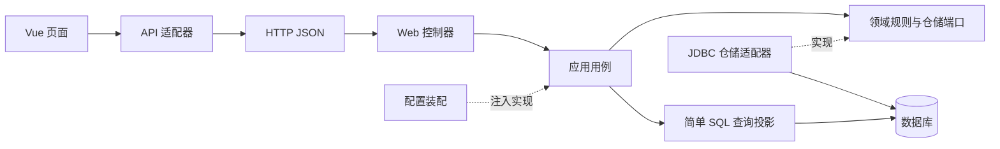
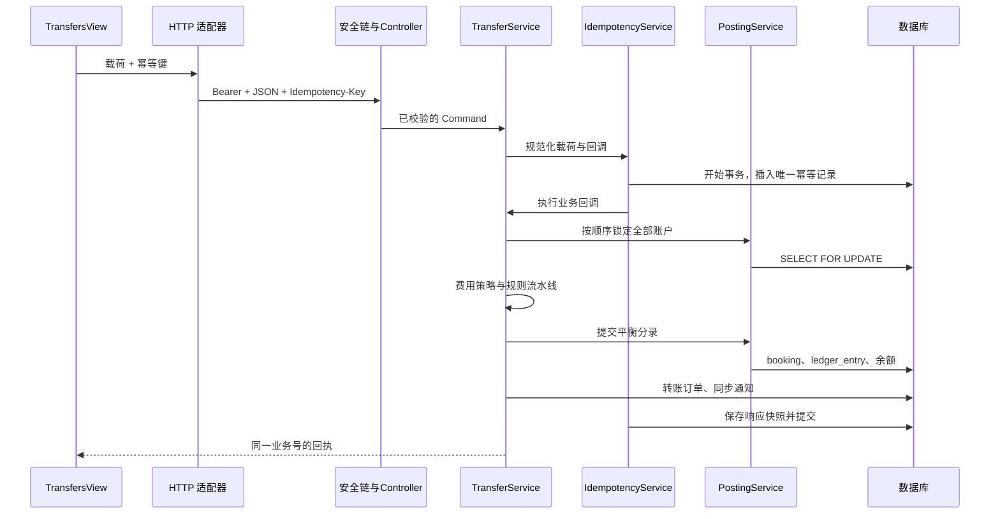
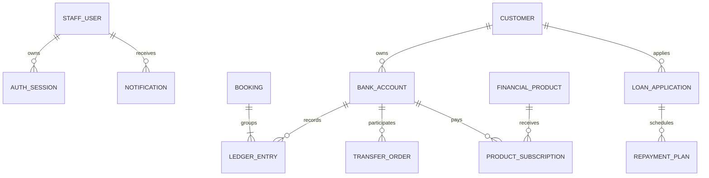

# Banking Academy · 完整教学手册

本文件由各章节合并生成。分章阅读入口为 [教学目录](README.md)。更新章节后运行 scripts/Build-Handbook.ps1 重新生成。

项目版本：1.0.0。示例全部使用虚构教学数据。


---


# 01 · 快速开始

## 环境

推荐 JDK 17 和 Node.js 24。Java 编译目标为 17；本次也在 Java 24 上运行过应用。前端固定使用 pnpm 11.25.0，版本和依赖由 package.json、pnpm-lock.yaml 记录。

不必额外安装 Maven：backend 已包含 Apache Maven Wrapper，首次运行会下载 Maven 3.9.9。请使用 JDK，而不是只有运行能力的 JRE。

在终端检查：

```powershell
java -version
node --version
pnpm --version
```

如果没有 pnpm，可通过已有的 Node 包管理工具安装项目声明的版本，例如 `npm install -g pnpm@11.25.0`。安装来源为官方 npm 软件包仓库。

## 方式一：Windows 脚本

在 `banking-academy` 目录运行：

```powershell
.\scripts\Start-Learning.ps1
```

脚本安装缺失的前端依赖、测试并打包后端、在后台启动两个服务，日志存放于 `artifacts/`。默认端口为前端 5173、后端 18080；已占用时会明确停止，避免误连其他项目。

已完成打包且源码没有变化时，可以使用 `-SkipBuild`。修改 Java 后需要重新打包；修改 Vue 后由开发服务器更新。

脚本不会自动打开浏览器。访问 [学习平台](http://127.0.0.1:5173)，选择演示账号。

停止：

```powershell
.\scripts\Stop-Learning.ps1
```

停止脚本只处理自己记录的 PID，并核对进程命令中的项目绝对路径，避免 PID 被复用后停止无关程序。

## 方式二：两个终端

后端终端：

```powershell
cd backend
.\mvnw.cmd spring-boot:run
```

前端终端：

```powershell
cd frontend
pnpm install --frozen-lockfile
pnpm dev
```

Linux/macOS 的后端命令替换为 `chmod +x mvnw`、`./mvnw spring-boot:run`。关闭两个终端中的服务可按 Ctrl+C。

访问 [健康检查](http://127.0.0.1:18080/api/health)，应返回 `code: OK` 和 `status: UP`。

## 演示身份

| 账号 | 密码 | 权限 |
| --- | --- | --- |
| admin | Learn@123456 | 业务操作、贷款审批和放款、审计查询 |
| teller | Learn@123456 | 客户、账户、转账、贷款申请、产品申购 |
| auditor | Learn@123456 | 业务只读查询、审计查询 |

三个账号属于银行内部员工角色。这里没有客户网银登录；内部员工默认可查询整个教学工作空间的数据。通知按照员工归属隔离。

## 十五分钟体验路线

1. 用 admin 登录总览，查看三位客户与三个账户，每个演示账户期初余额 100,000 元。
2. 创建自己的虚构客户，开立余额为零的账户。
3. 从 A1001 向新账户转账 100 元，查看双方流水。
4. 使用即时转账，再核对本金与手续费。100 元即时转账收费 1 元，转出账户共扣 101 元。
5. 冻结一个账户后尝试转账，观察后端业务错误；解冻后再操作。
6. 退出，用 teller 提交贷款申请，选择该客户自己的收款账户。
7. 退出，用 admin 审批并放款，查看放款流水与还款计划。
8. 用低风险承受能力的客户申购高风险产品，观察拒绝结果。
9. 用 auditor 登录，确认业务写入按钮不可用，并阅读操作审计。

默认三个演示账户 ID 为 A1001、A1002、A1003。新建账户使用 UUID，其 accountNo 为教学编号，不是真实银行卡号。

## 数据保存在哪里

默认 H2 数据文件位于后端工作目录下的 `data/academy.mv.db`。因此，请在 backend 目录启动后端；脚本已替你设置工作目录。重启后，客户、余额、流水与会话仍会保留。

自动测试使用独立内存数据库，不修改这个文件。需要重新开始学习时，先停止后端，把 `backend/data` 改名备份，再启动生成新数据。不要在应用运行时移动数据库文件。

## PostgreSQL 与容器化练习

项目提供可选 `compose.yml`，将 PostgreSQL、Java 后端和 Nginx 前端分开运行：

```powershell
Copy-Item .env.example .env
# 编辑 .env，设置本机教学数据库密码
docker compose up --build
```

访问 [容器练习入口](http://localhost:8088)。这是可选教学部署路径；本次没有实际运行容器或 PostgreSQL 验证，不能把配置文件的存在等同于部署已通过。

compose 启用 `demo,postgres`，仍会生成演示账号。若只启用 postgres，demo 初始化器不运行，需自行实现首次管理员配置。勿把含演示账号的配置直接用于真实业务。

## 常见问题

**登录页能打开，但登录失败**：先确认后端健康检查，再查看 `frontend/vite.config.ts` 的 `/api` 代理目标和后端 CORS_ORIGINS。默认允许 localhost:5173 与 127.0.0.1:5173。

**端口被占用**：检查已有学习服务是否仍运行。不要随意停止未知进程。若手动更改后端端口，还要同步修改前端代理。

**Java 编译错误**：检查 JAVA_HOME 是否指向 JDK 17 或更新且兼容的版本。Maven Wrapper 使用的 Java 可能与终端 `java` 不同，运行 `mvnw.cmd -version` 确认。

**打包时无法重命名 jar**：Windows 中，正在运行的 jar 可能被锁定。先停止后端，再执行 package。

**PowerShell 阻止脚本**：采用上述两个终端方式启动；不需要为项目修改整台机器的脚本执行策略。

**依赖下载慢或失败**：保留错误日志，检查网络和包仓库连通性。不要把真实代理密码、令牌写进项目文件或提交到仓库。


---


# 02 · 架构与模块边界

## 架构目标

项目的核心目标是让学习者能够解释复杂业务，而不只是调用框架。业务规则尽量集中、依赖尽量明确、变化影响范围尽量可预测。

后端是按业务组织的模块化单体：所有模块在一个 Spring Boot 进程、一个数据库中运行。前端是独立 Vue 工程，通过 HTTP JSON 接口交互。这里的“模块”是源码包边界，并不是多个 Maven 子工程，也不是多个独立服务。



## 先按业务，再按职责

传统目录把所有 Controller、Service、DAO 分别堆在一个大文件夹。功能变多后，修改客户业务要穿过多个庞大的目录。本项目先按 identity、customer、account、transfer 等业务组织，再在需要的模块内划分 domain、application、infrastructure、web。

并非每个模块都必须有四个空目录。只有实际需要独立变化的职责才拆分。产品与贷款当前使用应用服务编排 SQL，客户和账户则展示仓储接口与适配器的完整结构。

### Web 层

负责 URL、HTTP 方法、请求 DTO、参数校验、统一响应。CustomerController 把 HTTP 请求翻译为用例调用；它不应该计算手续费、执行 SQL、修改余额。

控制器通常可以很短。短不是追求本身，而是业务复杂度已经放到了更合适的位置。

### Application 层

负责一个业务动作的编排。例如 TransferService 取得当前员工、进入幂等事务、选择费用策略、锁定账户、执行规则、调用记账入口、保存订单并发布事件。

它可以依赖 Spring 的服务、事务和事件抽象。应用服务通常不适合做成“万能 BaseService”：不同业务的规则、权限、事务边界并不相同。

### Domain 层

负责稳定的业务语义。例如 Money 拒绝分以下精度，AccountStatus 管理状态迁移，FeePolicy 描述费用算法，RepaymentCalculator 维护计划计算骨架。

领域类不依赖 Spring、Web、JDBC 或应用层。ArchitectureTest 会检查这一点，因此它们可以直接 new 出来做快速单元测试。

### Infrastructure 层

负责具体存储技术。JdbcCustomerRepository 实现 CustomerRepository，JdbcAccountRepository 实现 AccountRepository，SessionRepository 实现 SessionStore。

领域端口只声明能力，如 find、lock、create；JDBC 实现处理表名、参数、行映射。替换为其他持久化实现时，领域模型无需知道新技术。

## 实际模块协作

| 发起方 | 依赖的能力 | 原因 |
| --- | --- | --- |
| 账户应用服务 | 客户查询 | 开户前确认客户存在 |
| 转账应用服务 | 记账服务、费用策略、规则、幂等 | 协调一次资金转移 |
| 产品应用服务 | 客户查询、记账、幂等 | 适配风险并完成申购扣款 |
| 贷款应用服务 | 账户查询、记账、计划算法 | 放款与状态、计划同步提交 |
| 记账服务 | 账户仓储端口 | 统一获取行锁和更新余额 |
| 通知模块 | BusinessCompleted 事件 | 发布方无需依赖通知保存逻辑 |

跨模块调用以明确的应用能力或领域端口为边界。不要从一个控制器直接调用另一个控制器；控制器是协议适配器，不是可复用的业务接口。

## 高内聚如何体现

手续费公式留在手续费策略，金额精度留在 Money，账户余额变化规则留在 Account，统一写账留在 PostingService，HTTP 头处理留在 http.ts。相关变化集中，修改时容易找到正确位置。

如果“冻结账户不能转账”的判断在五个页面、三个控制器和两个 SQL 中重复，就算类文件很多，也不代表内聚良好。

## 低耦合如何体现

构造器显式声明依赖；领域不引用框架；仓储由端口定义；手续费算法以接口替换；通知使用事件；前端组件使用统一 API 适配器。每一种方式都针对一个真实变化点。

低耦合不意味着完全没有依赖。转账必须依赖账户能力，否则无法转账。关键是依赖是否符合业务方向、是否稳定、是否容易被解释。

## 为什么查询仍有 SQL

报表、流水和列表查询直接通过应用层 JDBC 投影生成响应，不强制经过仓储接口与聚合对象。这样减少一层没有独立价值的搬运代码，适合展示读写职责分离的入门形式。

本项目不是严格的完整六边形架构实现：部分事务编排仍使用 JDBC、应用服务之间仍有直接依赖，事件类型位于通知模块的领域包。后续可将事件移入独立 contracts 包，把复杂写入提取为端口。文档不把这些取舍包装成已经实现的隔离。

## 一个判断练习

需求“即时转账手续费最高 30 元”：修改 InstantFeePolicy 和对应测试即可。需求“增加转账渠道”：增加枚举、策略、装配与前端选项。需求“更换数据库”：重点检查 SQL 方言、驱动、迁移与并发测试。需求“页面改色”：不应修改业务规则。

每次修改前，先写一句“这条规则由谁拥有”。这句话往往比先画大量类图更有帮助。


---


# 03 · 一笔转账的全链路

以 A1001 向 A1002 即时转账 100 元为例，目标结果是 A1001 减少 101 元、A1002 增加 100 元、内部手续费账户增加 1 元，只产生一笔业务订单。

## 先建立调用地图



## 第一步：表单只维护输入

打开 `frontend/src/views/TransfersView.vue`。form 是一个 reactive 对象，amount 保持字符串，不做 JavaScript 浮点加减。MoneyInput 提供输入模式和原生格式约束，但真正的金额规则仍由服务端执行。

提交时通过 `{ ...form }` 创建快照，避免正在执行的请求与用户继续编辑表单共享可变引用。useCommand 控制 pending、防止同一页面重复点击，并统一显示错误。

前端按钮禁用只改善交互。用户可以直接发 HTTP 请求，也可能打开多个标签页，因此服务端仍必须独立处理重复请求。

## 第二步：幂等键代表一次业务意图

createIdempotentExecutor 为当前载荷生成 UUID 键。请求失败时保留该键，同样载荷重试继续使用；成功后清空；载荷改变则生成新键。

这是一个页面生命周期内的重试策略。刷新页面或重新打开弹窗后，内存中的键可能丢失。因此网络结果不确定时应先查询业务记录，再决定是否新建一笔；跨页面持久化业务草稿是后续练习。

## 第三步：HTTP 适配器处理协议

`api/bank.ts` 定义 transfer 函数，`api/http.ts` 统一添加 Authorization、Content-Type 和 Idempotency-Key，设置超时、解包 ApiResponse，并把业务错误保留为 ApiError。

为什么拆两个文件？bank.ts 理解“转账是什么”，http.ts 理解“如何发送 HTTP”。改变响应信封不需要修改所有页面；改变转账路径不需要修改通用请求器。

## 第四步：先认证，再授权，再执行业务

TraceFilter 为请求创建追踪号。BearerTokenFilter 将令牌哈希后查询有效会话，生成包含权限的认证对象。Spring Security 拒绝未登录请求。

TransferController 接收 @Valid DTO，将其转换为 Command。TransferService.transfer 上的 @PreAuthorize 要求 transfer:write。auditor 即使绕过页面手工提交，也会收到 403。

DTO 处理长度、非空、格式；领域和值对象处理业务语义。两者重复检查部分规则是有意的：HTTP 入口不能成为领域模型唯一的保护。

## 第五步：在独立事务中占用幂等键

IdempotencyService 使用 TransactionTemplate 开始事务，先插入 `(scope, request_key)` 唯一记录。scope 包含用例和员工 ID，防止不同员工的键互相复用。

若同键已提交，插入会冲突；失败事务退出后，再读取已有响应。请求指纹相同则返回原回执，不再执行扣款；指纹不同则返回 IDEMPOTENCY_CONFLICT。

指纹是规范化请求 JSON 的 SHA-256。金额 100 和 100.00 会先转换为同样的两位小数。备注仍参与指纹：同一个键不能偷偷改为另一笔有不同备注的业务。

为什么不在失败事务内部查询？PostgreSQL 的唯一键冲突会使当前事务进入中止状态，继续查询也无法正常工作。代码在事务外捕获 DuplicateKeyException，就是为避免这个常见错误。

## 第六步：获取账户行锁

即时转账涉及源账户、目标账户、SYS-FEE。PostingService.lockAccounts 先去重、排序，再依次执行 SELECT FOR UPDATE。

源账户锁让余额与日累计限额的检查串行执行。两个线程不能同时依据同一份旧余额完成扣款。所有调用按相同顺序锁定账户，可减少 A→B 与 B→A 造成的循环等待。

排序只能降低账户锁顺序导致的死锁，不能保证整个系统永不死锁。跨产品行、贷款行和账户行的新增事务仍需分析全局锁顺序。

## 第七步：执行规则与算法

FeePolicyRegistry 根据渠道选择算法：标准免费；即时按 0.1% 计算，最低 1 元、最高 20 元，HALF_UP 到分。

规则按装配顺序执行：检查普通客户账户、账户不同、状态正常、余额足够支付本金与手续费，再检查单笔 20,000 元和每日 50,000 元限额。

日累计以 Asia/Shanghai 当天零点为起点，只统计已成功提交的转账本金，不统计手续费。这是明确的教学业务口径；修改口径时要同时修改规则与测试。

## 第八步：写入平衡分录

本次分录为：

| 账户 | 余额变动 |
| --- | ---: |
| A1001 | -101.00 |
| A1002 | +100.00 |
| SYS-FEE | +1.00 |
| 合计 | 0.00 |

PostingService 验证分录至少两项、金额和为零、账户不重复、变动不为零，预先计算每个账户的新余额，再写 booking、余额快照和 ledger_entry。

这里实现的是教学用的“余额增减平衡模型”，没有完整会计科目、借贷方向、币种、总账与分户账系统。不要把求和为零等同于完整银行会计。

## 第九步：订单、通知和响应一起提交

TransferService 保存订单，发布 BusinessCompleted。NotificationService 的 @EventListener 同步执行并写数据库，参与当前事务。

IdempotencyService 保存回执 JSON，事务提交。若中间任意一项失败，幂等占位、余额、分录、订单和通知一起回滚。测试用事件监听器在记账后抛异常，专门验证了这个性质。

AuditAspect 在业务提交并成功返回后尝试记录操作名、员工与追踪号。它是独立的最佳努力操作审计；它不属于资金原子提交的一部分，也不保证失败调用被记录。

## 第十步：页面展示结果

收到回执后，页面展示业务号、金额和手续费，刷新记录与账户选项。页面本身不推测新余额，而是重新查询后端结果。

## 带着问题再读一次

如果扣款成功但网络断开，前端知道成功了吗？为什么要保存完整响应？如果目标账户被冻结，在哪一层拒绝？如果通知监听器抛异常，哪个事务回滚？如果把 @EventListener 改成异步，当前原子性还存在吗？

建议先独立回答，再对照第 05、06、08 章与实际测试。


---


# 04 · 设计模式实战

设计模式是对变化的组织方式。先判断什么会变，再选择结构；不需要为了出现更多模式名而制造没有职责的类。

## 策略：手续费算法

位置：`transfer/domain/FeePolicy.java`、StandardFeePolicy、InstantFeePolicy、`transfer/application/FeePolicyRegistry.java`。

稳定部分是“根据渠道取得费用”，变化部分是“费用如何计算”。FeePolicy 定义 channel 和 calculate；两种算法实现同一接口。TransferService 只要求费用结果，不需要知道各个公式。

注册表用 EnumMap 保存渠道与策略，在构造时拒绝重复策略，并检查所有渠道都有实现。这把漏配错误提前到启动阶段，而不是让用户在提交业务时才遇到空指针。

学习路径：先把两个算法写成 if/else，观察 TransferService 会承受哪些变化；再对照接口和注册表，理解额外几个类换来了什么。

新增渠道的步骤：增加 TransferChannel 枚举；编写策略；在 BusinessPolicyConfiguration 装配；补测试；更新前端渠道类型和选项。Java 编译器与注册表分别检查类型和配置的完整性。

不把每个简单条件都抽成策略。如果只有一个稳定公式，一个普通方法往往更合适。

## 规则流水线：转账校验

位置：TransferRule、AccountAvailabilityRule、TransferLimitRule、BusinessPolicyConfiguration 的 @Order。

每条规则负责一组相关判断，按顺序执行，失败时抛出明确异常并中止后续处理。本实现由应用服务遍历 List，不是每个处理器自己保存 next 指针的经典链式结构；更准确地说，是责任链思想的规则流水线实现。

它适合持续增加相对独立的校验，例如黑名单、营业时间、渠道维护状态。它不适合让规则偷偷修改余额或写数据库，否则“校验顺序”会混入副作用和复杂事务。

TransferContext 是不可变输入，里面提供锁定后的账户、金额、费用和日累计。规则不用各自重复查数据库，从而避免读取不一致和隐藏性能成本。

## 模板方法：贷款计划

位置：loan/domain/RepaymentCalculator、EqualPrincipalCalculator、EqualInstallmentCalculator。

两个算法都需要：校验本金与期限、计算月利率、逐期循环、计算利息、确定日期、处理最后一期尾差。因此父类的 final calculate 固定骨架，子类只实现 principalFor。

等额本金将本金平均分配，最后一期吸收分币尾差。等额本息先计算固定期供，再减去当期利息得到本金部分。所有中间计算使用 BigDecimal，明确每一步舍入位置。

父类不允许子类覆盖 calculate，是为了保护“计划本金合计等于原本金”等公共约束。反过来，如果各种算法连循环方式和日期规则都不同，就不应强行共用这个父类，改为独立策略更自然。

思考：为什么不能每期直接保留两位小数后就结束？100 元分三期会得到 33.33 × 3 = 99.99；最后一期必须承担 0.01 的差额。

## 状态机：账户与贷款

位置：AccountStatus、LoanState。

账户允许 ACTIVE→FROZEN、ACTIVE→CLOSED、FROZEN→ACTIVE，CLOSED 不允许恢复；销户还必须余额为零。贷款只允许待审批审核、批准后放款，重复放款会被状态和业务唯一键共同限制。

当前状态行为很少，用枚举和显式判断足够。它是有限状态机，不是完整的 GoF State 对象体系。状态出现大量不同操作、入口行为或退出行为后，再将其提取为独立 State 类。

把状态限制放在后端，是因为页面刷新、重复请求或手工 HTTP 都可能绕过按钮。先查再改还不够，贷款审核和放款必须在行锁保护下检查状态。

## 观察者：业务完成与通知

位置：BusinessCompleted、ApplicationEventPublisher、NotificationService.onCompleted。

转账发布不可变事件，通知模块监听事件并保存通知。转账不用引用 NotificationService，因此新增一个统计监听器时，不必修改转账流程。

这里选择同步事件：监听器参与同一事务。代码没有承诺消息队列、跨服务投递或失败重试。若改为 @Async 或在提交后发送邮件，就需要重新定义失败语义。

进阶方案是事务 outbox：业务事务只把事件写入数据库；独立投递器重试外发；消费者按事件 ID 幂等。本项目把它作为练习，未虚构成已经具备的能力。

## 适配器与依赖倒置：仓储

CustomerRepository、AccountRepository、SessionStore 描述应用需要的能力，JDBC 实现适配具体技术。高层用例声明构造器依赖端口，Spring 配置完成实现注入。

接口有价值的前提是它承载稳定的业务能力，而不只是给每个类机械创建一个同名接口。查询投影没有强行增加一层接口，就是对抽象成本的控制。

## 代理与切面：审计

@Audited 是一个标记。AuditAspect 通过 Spring AOP 拦截代理调用，读取注解的动作名。审计行为与业务方法分离，避免每个方法重复拼接日志 SQL。

这是横切关注点的组织方式。切面适合操作审计、指标采集；业务核心的扣款和限额不应隐藏在命名模糊的切面里，否则调用链难以理解。

## 模式选择表

| 变化 | 当前方式 | 何时不值得使用 |
| --- | --- | --- |
| 同一目标，多种算法 | 策略 | 只有一个短小且稳定的公式 |
| 多条独立校验 | 规则流水线 | 两个简单条件，几乎不会扩展 |
| 流程相同，少量步骤不同 | 模板方法 | 各流程大部分步骤不同 |
| 动作取决于当前状态 | 状态机 | 状态本身没有行为约束 |
| 业务完成触发附加动作 | 观察者 | 必须拿到另一服务的同步计算结果 |
| 外部技术需要替换或隔离 | 端口与适配器 | 一次性脚本或极简单的投影 |
| 多处重复的非业务行为 | AOP 代理 | 实际上属于核心业务规则 |

读完后尝试回答：删掉某个模式，代码会在哪个变化点变难？如果回答不出来，说明这个抽象可能并不需要。


---


# 05 · 注解与代理机制

注解自身通常不执行代码。它是元数据，必须由编译器、反射、容器、校验器或代理读取后才产生效果。学习注解时，始终追问“谁读取它，什么时候读取”。

## 注解速查

| 注解 | 本项目位置 | 读取方与作用 |
| --- | --- | --- |
| @SpringBootApplication | BankingApplication | 启动自动配置与组件扫描 |
| @Configuration / @Bean | config 包 | 装配安全链、Clock、策略等对象 |
| @Component / @Service / @Repository | 各职责层 | 注册容器组件并表达角色 |
| @RestController / @RequestMapping | web 包 | 建立 HTTP 路由与 JSON 响应 |
| @RequestBody / @RequestHeader | Controller | 从请求体或请求头绑定参数 |
| @Valid | Controller DTO | 触发 Bean Validation |
| @NotBlank / @Size / @Pattern | 请求 record | 声明字段约束 |
| @MoneyAmount | 金额字段 | 自定义十进制金额校验 |
| @EnableMethodSecurity | SecurityConfiguration | 启用方法授权代理 |
| @PreAuthorize | 写用例及审计查询 | 在方法执行前检查权限 |
| @Transactional | 应用用例、记账服务 | 声明事务与传播约束 |
| @Audited | 业务命令方法 | 提供操作名供审计切面读取 |
| @Aspect / @Around | AuditAspect | 执行环绕拦截 |
| @Order | 规则 Bean、审计切面 | 控制规则和切面的相对顺序 |
| @EventListener | NotificationService | 订阅同步业务事件 |
| @Profile("demo") | DemoDataInitializer | 只在教学配置初始化账号数据 |

## 自定义参数校验

打开 MoneyAmount：@Target 指定可标记字段、参数、record 组件等位置，@Retention(RUNTIME) 保证运行期校验器可以读取，@Constraint 指定 MoneyAmountValidator。

Validator 检查非空、正值、最多两位小数与金额上限。默认 message 表达用户可理解的约束；groups 和 payload 遵循 Bean Validation 契约。

注意：把注解写在字段上并不自动触发校验。当前 HTTP 入口依赖 @Valid。直接调用应用服务时，Money.positive 等领域校验依然必要。

实践：去掉某个请求参数的 @Valid，再提交三位小数，观察约束是否仍触发；完成实验后恢复。这个实验能帮助区分“声明约束”与“触发约束”。

## 事务代理何时生效

Spring 通常创建目标 Bean 的代理对象。调用方通过代理进入方法时，代理先开启事务，执行目标方法，再提交或回滚。

本项目使用构造器注入，使调用方拿到容器管理的代理。不要在应用代码中 `new AccountService(...)` 后期待 @Transactional 自动工作。

同一个对象内通过 `this.otherMethod()` 自调用，通常不经过外部代理。因此把事务注解放在 private execute 上不会建立期望的事务。TransferService 有 private execute，但它由 IdempotencyService 的 TransactionTemplate 显式包裹，事务来源不是这个 private 方法的注解。

PostingService 使用 `Propagation.MANDATORY`。它不是自己启动独立资金事务，而是要求调用方已经有事务；没有就立即失败，防止流水和订单分开提交。

## 方法授权

SecurityConfiguration 的 @EnableMethodSecurity 开启授权能力。@PreAuthorize 使用 Authentication 的权限集合；例如 transfer:write 允许转账，audit:read 允许审计查询。

权限放在应用用例方法上，使 HTTP 控制器之外的容器调用也受到约束。当前系统仍是内部员工工作台，没有客户级账户所有权授权模型。若增加客户登录，必须增加资源归属校验，不能沿用当前“员工可读整个工作空间”的规则。

前端 auth.can 控制按钮和导航，只是交互层。服务端权限才决定是否允许写入。

## 审计注解从声明到执行

@Audited("TRANSFER_SUBMIT") 描述操作语义。AuditAspect 的 @Around 在方法成功返回后保存 actor、action、traceId、createdAt。

切面没有反射打印全部参数，因为登录凭据、令牌和客户信息不该随意进入操作日志。审计记录只描述当前实现能够可靠识别的信息。

AuditAspect 的顺序为 300，普通事务拦截器使用默认较后顺序。审计包住事务方法，因此成功审计发生在业务事务提交后。若提交失败，业务调用不会成功返回，也不会写成功审计。

审计保存失败时会记录服务日志，已提交业务仍返回成功。生产中若要求操作审计不可丢失，应实现事务 outbox 或同事务审计设计，并明确失败策略。当前没有失败审计、登录审计和不可篡改存储。

## 两种 @Order 不要混淆

规则上的 @Order(10)、@Order(20) 控制注入到 List<TransferRule> 的顺序。切面上的 @Order(300) 控制 AOP 拦截顺序。二者都用顺序元数据，但参与排序的对象和执行机制不同。

更小的切面顺序通常位于外层，先进入、后退出；这会影响审计发生在事务之前还是提交之后。不要凭注解在源码中的书写上下位置推断执行顺序。

## 可观察性

TraceFilter 创建 UUID，写入 MDC 和 X-Trace-Id 响应头，ApiResponse 同时返回 traceId。finally 中清理 MDC，避免 Web 线程复用时串号。

拿到错误的追踪号后，在后端日志中搜索同一个值，就能定位该请求。这里实现单进程请求关联，没有跨服务分布式追踪，也没有自动携带外部传入追踪号。

## 小结练习

给开户方法增加一个 @Audited 值，确认审计出现；给一个未被容器管理的普通对象加 @Transactional，解释为什么不会工作；调用 PostingService 而不建立事务，观察 MANDATORY 约束。每个实验都要说明“元数据的读取者”。


---


# 06 · 数据库与资金一致性

## 表与业务的关系



迁移脚本 `V1__schema.sql` 是表结构的真实来源。Flyway 在启动时检查并执行，历史文件一旦使用后应保持不变；新结构使用 V2、V3 等新迁移。

## 三种数据角色

业务单据描述“发生了什么”：transfer_order、loan_application、product_subscription。

booking 和 ledger_entry 描述“资金如何变化”。每个 booking 使用唯一 business_key，防止同一业务重复记账；分录的账户组合与金额维护平衡约束。

bank_account.balance 是便于查询的余额快照。它必须与所有历史分录之和一致，不能用管理员随意编辑余额的方式修改。本项目演示期初余额同样经过 PostingService。

## 金额的三道边界

HTTP 使用字符串，如 "100.01"。MoneyAmount 校验输入，拒绝第三位小数。Java 使用 BigDecimal 与 Money 值对象。数据库使用 DECIMAL(18,2)，普通客户账户还有余额非负约束。

Money 不接受隐式舍入，例如 1.001 不能悄悄变成 1.00。手续费和贷款利息涉及计算结果时，算法明确使用 HALF_UP，业务输入与算法舍入是两个不同问题。

JSON 响应通过 JsonConfiguration 把 BigDecimal 序列化为字符串。前端展示金额直接做字符串分组，不让 Number 参与资金运算。产品年化百分比转成 Number 只用于页面展示，不用于结算。

## 事务保护哪些写入

转账的幂等占位、记账组、余额、分录、订单、同步通知、响应快照，在同一个数据库事务中提交。

贷款放款的状态更新、放款分录、账户余额、还款计划、通知，也在同一个事务中提交。产品申购的额度变化、扣款、归集、订阅记录与通知同理。

审计发生在成功提交之后，属于最佳努力记录；不在上述资金事务里。

## 为什么“先查余额再更新”不安全

假设余额 100，两次并发请求各扣 80：如果都读到 100，都认为足够，最后可能产生覆盖更新或超额支付。事务本身不保证业务检查自动串行化。

本项目使用 SELECT FOR UPDATE 获取账户行锁，持锁期间检查余额与额度，再更新。竞争者要等前一个事务结束，才能读到新的账户状态。

账户状态变更也获取同一账户锁，防止冻结与转账互相穿透。贷款审核/放款锁定贷款行；产品申购先锁产品行，再按统一顺序锁相关账户。

客户风险承受能力的修改当前不与申购统一加锁，这意味着并发修改评级时，申购可能依据查询当时的评级通过。若业务要求强一致审批评级，应引入版本号或客户行锁，并评估跨模块锁顺序。

## 幂等不是按钮防抖

按钮防抖只处理当前页面重复点击。幂等通过数据库唯一键保护服务端业务。相同 scope、key、payload 返回原结果；相同 key 不同 payload 明确冲突。

键记录和业务在同一事务：业务失败，键记录回滚，下次可再次尝试；业务已成功，重试得到原业务号。

表中的 created_at 便于未来清理，但当前不自动清理幂等记录。若实现过期策略，必须定义客户端重试窗口以及记录过期后重复扣款的风险。不要只按“表太大了”直接删记录。

幂等键不是权限令牌，也不是业务流水号。不同员工使用相同文本键属于不同 scope；这有利于接口隔离，但不能跨员工识别同一业务意图。

## 约束的分工

| 约束 | 所在位置 | 作用 |
| --- | --- | --- |
| 手机号唯一 | 数据库 UNIQUE | 并发创建也能阻止重复 |
| 分录组业务键唯一 | booking.business_key | 阻止重复业务记账 |
| 客户余额非负 | Account + CHECK | 领域可读错误 + 存储兜底 |
| 请求键唯一 | 幂等表复合主键 | 并发同键只执行一次 |
| 贷款期数唯一 | repayment_plan 唯一键 | 避免重复生成同一期 |
| 分录和为零 | PostingService | 跨行聚合不变量 |

分录和为零不是一个普通单行 CHECK 能解决的约束。当前由统一入口和事务保护；若允许外部程序直接写表，还需要额外的数据库或权限治理。

## 对账 SQL

找出不平衡的分录组：

```sql
SELECT booking_id, SUM(amount)
FROM ledger_entry
GROUP BY booking_id
HAVING SUM(amount) <> 0;
```

找出余额快照与分录累计不一致的账户：

```sql
SELECT a.id, a.balance, COALESCE(SUM(e.amount), 0) AS ledger_balance
FROM bank_account a
LEFT JOIN ledger_entry e ON e.account_id = a.id
GROUP BY a.id, a.balance
HAVING a.balance <> COALESCE(SUM(e.amount), 0);
```

两条查询均应没有结果。BankWorkflowTest 中有对应断言。

## 查询与性能

列表提供服务端分页，每页最多 100；前端选择器也分页，避免把“加载前 100 个”误当成全部账户。搜索用绑定参数阻止 SQL 注入；当前允许 % 和 _ 作为 LIKE 通配符。

流水账户索引、转账来源与时间索引、通知员工索引用于常见查询。小数据下很多 SQL 都很快，但扩大到百万级后仍需 EXPLAIN、索引选择性、游标分页和聚合优化。

日报表当前执行七个日期区间查询，设计直观且适合入门。大数据量可合并成分组查询或增量统计表；不能仅因存在索引就断言性能已满足真实银行规模。

## H2 与 PostgreSQL

H2 的 PostgreSQL 模式便于本地启动，但不能模拟 PostgreSQL 的所有隔离、异常码、时间和锁行为。现有测试验证的是 H2 路径。切换真实数据库后，应重新验证同键并发、对向转账、锁等待、异常后的事务状态和时间边界。

迁移脚本与配置提供了 PostgreSQL 路径；容器启动和真实数据库回归尚未在本次交付中执行。


---


# 07 · 前端工程与组件设计

## 页面、组件、状态分别负责什么

views 组织一个业务页面，components 表达可复用交互，api 适配后端接口，types 描述共享数据结构，stores 保存跨页面状态，composables 抽取有状态的流程能力。

例如客户列表页面负责筛选和编辑流程；DataTable 只负责表格结构和插槽；bankApi.customers 负责查询路径与参数；useResource 负责加载状态和请求竞态。每个文件都有可以解释的职责。

## 为什么使用 Composition API

页面用 `<script setup lang="ts">`，把与某个业务动作相关的状态和函数放在一起。TypeScript 能检查 DTO、API 返回值、组件属性和事件，不替代运行期校验。

reactive 适合表单对象，ref 适合单值与可选对象，computed 适合由已有状态推导的值。不要把可以从其他状态计算出的结果重复保存，否则多个值可能不一致。

## 类型从接口边界开始

types/models.ts 定义 Account、Transfer、Loan 等接口以及 Page<T>。金额类型 Money 是 string 的语义别名。它提供可读性，不具有品牌类型那样的编译期独立性，后续可作为类型练习增强。

接口演进时，应同步修改后端 DTO、前端类型和接口文档。TS 不会检查服务器实际发送的 JSON；当前适配器采用类型声明，未引入运行期 schema 校验。若对外部不可控接口集成，可增加 Zod 等校验器。

## 通用 HTTP 适配器

request<T> 统一处理认证头、15 秒超时、响应信封、401 和 ApiError。页面接收 Promise<T>，不需要每次手工读取 response.data.data。

超时只代表客户端没有拿到结果，不代表服务端已回滚。对于资金操作，不能超时后自动换键再提交。本项目把这件事明确放到幂等执行器中处理。

401 会清除 sessionStorage 令牌，发送 session-expired 事件，由 main.ts 清空 Store 并跳转登录页。403 代表已登录但无权限，不应误当成会话失效。

令牌保存在 sessionStorage，便于教学和标签页隔离，但可被页面脚本读取。生产身份方案还需结合 XSS 防护、CSP、令牌生命周期与 Cookie/CSRF 等设计；当前未实现完整的生产身份体系。

## useResource：处理读请求

它返回 data、loading、error、reload。每次 reload 增加 version，只有最后一次请求可以写入状态。

假设用户快速翻页：第 1 页请求慢、第 2 页请求快。若不处理竞态，旧响应最后回来会把页面覆盖成第 1 页。版本号方案让“最后发起的请求”取得更新权。

onScopeDispose 增加版本，使组件销毁后的迟到响应失效。它没有取消后台网络请求，只忽略过期结果；如需节省网络资源，可再注入 AbortSignal。

测试用两个可手工 resolve 的 Promise，先完成新请求再完成旧请求，证明新页不被覆盖。

## useCommand：处理写动作

它维护 pending，重复点击时直接退出，捕获错误并交给 Toast Store。返回值为 T 或 undefined：页面仅在获得结果后关闭弹窗和刷新查询。

不要在调用前立刻关闭弹窗，否则后端失败时用户会丢失输入。也不要仅凭点击按钮就乐观扣减资金余额，资金结果应以服务器回执和重新查询为准。

createIdempotentExecutor 与 useCommand 职责不同：前者决定业务键生命周期，后者控制本地交互。两层分别防止网络重试和界面连点问题。

## Pinia 只保存跨页面状态

auth Store 保存员工、权限和身份初始化状态；toast Store 保存全局提示。客户编辑表单、当前页码和选中贷款留在页面，不放进全局 Store。

全局状态越多，页面之间越容易产生意外依赖。判断标准是：离开当前页面后，其他页面是否仍需要这份状态？如果没有，优先局部管理。

## 路由与布局

WorkspaceLayout 提供侧边栏、顶部员工信息与主内容区域。各业务页面通过 RouterView 加载，路由使用动态 import 拆分页面资源。

meta.public 标记登录页；meta.permission 控制审计页导航。导航守卫先恢复身份，再决定是否允许进入。后端仍独立授权，路由守卫不是安全边界。

生产静态部署必须把不存在的前端路径回退到 index.html，否则刷新 /loans 会得到 404。frontend/nginx.conf 给出了这项配置。

## 组件契约

| 组件 | 输入 | 输出 | 不应承担的工作 |
| --- | --- | --- | --- |
| DataTable | rows、columns、loading、error | 插槽、retry | 业务查询与权限判断 |
| Pagination | page、total、size | change | 修改父页面数据 |
| MoneyInput | 十进制字符串 | update:modelValue | 计算余额或手续费 |
| StatusBadge | 状态文本 | 无 | 修改业务状态 |
| AppModal | title | close | 保存客户或提交贷款 |
| AccountSelect | 选中 ID、可选客户 ID | update:modelValue | 断言账户最终可用 |

AccountSelect 与 CustomerSelect 属于业务选择组件，因此可以调用相应 API。它们不是纯展示组件，目录中可按项目规模进一步分为 ui 和 business。

## 可访问性与响应式

输入有 label 与 ID，按钮使用原生 button，表格提供表头，错误提示和 Toast 有相应语义。弹窗使用原生 dialog/showModal，支持键盘取消和原生焦点约束，关闭时尽量恢复焦点。

小屏侧边栏变成菜单，卡片由多列变为单列，表格允许横向滚动。不要为保留桌面布局而让整页水平溢出。

## 自己做一次拆分

从 CustomersView 选出“客户表单”部分，提取为 CustomerForm 组件，保留数据通过 props 进入、事件向外发送。先记录原有行为，再重构，确认编辑失败仍保留输入、保存成功仍刷新列表。

不要为了让页面行数变少就拆出只能叫“Part1”的组件。组件名应该表达用户可理解的职责。


---


# 08 · 测试与调试

## 验证命令

在根目录执行 `.\scripts\Verify.ps1`。或者分别运行：

```powershell
cd backend
.\mvnw.cmd test
```

```powershell
cd frontend
pnpm format:check
pnpm test
pnpm build
```

构建包含 TypeScript 类型检查与 Vite 生产打包。后端 package 会额外生成可运行 jar；Windows 下先停止正在运行的旧 jar。

## 测试分层

MoneyAndPolicyTest 不启动 Spring，验证领域算法。BankWorkflowTest 启动真实 Spring 上下文、真实内存数据库与 MockMvc 请求管线，验证安全、SQL、事务和业务协作。ArchitectureTest 约束领域依赖和控制器边界。

前端使用 Vitest 检查请求适配器、请求竞态和幂等键生命周期，使用 Vue Test Utils 验证金额输入。它们不等同于完整浏览器端到端测试；本次另有人工浏览器业务走查。

## 先找不变量

| 业务不变量 | 验证方式 |
| --- | --- |
| 金额不能有分以下精度 | Money 与 DTO 非法输入测试 |
| 即时手续费有最低与封顶值 | 多组边界参数 |
| 每期本金总和等于贷款本金 | 两种算法累计断言 |
| 同一幂等键只扣一次 | 顺序重放与多线程同键 |
| 每日限额不能被并发穿透 | 四线程竞争同一源账户 |
| 已记账后异常不能留下半笔业务 | 同步事件监听器故障注入 |
| 余额快照等于历史分录累计 | SQL 聚合对账 |
| 申请人与审核人不同 | 自审拒绝路径 |
| 审计员不能写业务 | 真正 HTTP 权限断言 |
| 员工不能标记他人的通知 | 数据归属校验 |

关注这些业务结果，通常比为每个 getter 写一个测试更有价值。

## 回滚测试为什么要在后面制造异常

如果余额检查就失败，只能证明“提前拒绝没有写入”。它不能证明已经修改余额以后还能完整回滚。

BankWorkflowTest 注册测试专用 FailureSwitch。开启后，它在 BusinessCompleted 事件处理时抛出异常，此时分录、余额和订单已经执行了 SQL，但事务尚未提交。测试确认双方余额、分录组、通知与幂等占位全部恢复。

这个测试验证真实事务，不用 mock 模拟“假装回滚”。故障开关只存在于 test 源码，不进入可运行应用。

## 并发测试的关键点

CountDownLatch 让多个工作线程同时开始，ExecutorService 管理线程，Future 用超时防止测试无限等待。Spring Security 上下文属于线程本地，每个工作线程必须显式设置并在 finally 中清理。

测试直接调用受代理保护的 TransferService，仍使用真实事务与数据库锁。不要把整个并发测试包进一个测试线程的 @Transactional 后，又期待其他线程共享它。

当前并发测试在 H2 中运行，不能替代 PostgreSQL 环境的锁与隔离回归。若要评估真实负载，还需单独的压力测试、锁等待监控和失败重试策略。

## 架构测试

领域不能依赖 Spring、Jakarta、Web、Application、Infrastructure 或 Config；基础设施不能依赖 Controller；Controller 不能依赖具体仓储适配器或 JDBC。

这些约束是代码中的可执行边界。它们不是完整证明：例如模块之间的循环依赖、SQL 业务语义和事务边界仍需要评审。

## 调试一笔转账

先在 TransferController.transfer 打断点，观察 DTO 中的金额类型；进入 TransferService.transfer，观察规范化 Command；进入 IdempotencyService.execute，确认事务起点；进入 PostingService.lockAccounts，观察排序结果；进入 post，检查分录和为零；最后观察响应快照与提交。

调试重复请求时，第二次应进入唯一键冲突分支，读取已存响应，不再进入 execute 的业务回调。

调试贷款时，在 LoanService.lock、review、disburse 与 RepaymentCalculator.calculate 放断点，观察状态检查、放款日和最后一期尾差。

## 前端调试

浏览器网络面板查看 Authorization、Idempotency-Key、响应状态和 traceId。只在自己的本地教学环境查看演示令牌，不把真实令牌粘贴到截图或公共问题单。

组件状态错误先判断属于 form、resource、auth 还是 command。数据加载失败不应误当成空列表；表格提供 error 与 retry。

遇到“点击成功但列表未变”，检查请求是否成功、reload 是否执行、是否有迟到旧请求覆盖；遇到“金额不对”，先检查字符串是否被 Number 转换。

## 让失败信息帮助定位

HTTP 400 表示请求格式或字段约束不合法；401 表示身份缺失或过期；403 表示无权限；404 表示对象不存在或不属于当前员工；409 表示业务规则冲突。

业务 code 比中文 message 更适合前端分支判断。traceId 用于查日志，不应在客户端伪造为业务依据。

## 测试仍有边界

没有在本次交付中执行真实 PostgreSQL、Docker 和 GitHub Actions；没有浏览器自动化回归全集；没有全量渗透测试、性能基准或金融合规验证。已有测试证明的是对应场景，不代表其他环境和全部风险都已覆盖。

当前也覆盖了零余额付款拒绝、产品额度不足、会话到期。下一步可增加北京时间零点切换、锁等待超时、客户评级与申购并发、跨页面幂等草稿恢复等测试。


---


# 09 · 接口参考

## 通用约定

本地基地址：`http://localhost:18080/api`。前端开发时访问同源 `/api`，由 Vite 代理转发。JSON 请求使用 `Content-Type: application/json`。

除健康检查和登录外，接口需要 `Authorization: Bearer <token>`。金额、费用、余额和利率在响应中是十进制字符串。时间为带偏移的 ISO 8601 字符串；还款日期为 YYYY-MM-DD。

正常响应：

```json
{
  "code": "OK",
  "message": "操作成功",
  "data": { "id": "业务对象ID" },
  "traceId": "请求追踪号"
}
```

失败响应保留 code、message、traceId，data 为 null。不要依赖中文 message 的精确文本判断业务分支。

分页接口使用从 1 开始的 page，默认 1；size 默认 10，范围 1~100。page 最大 100000。响应 data 为 `{ "items": [], "total": 0, "page": 1, "size": 10 }`。

## 权限说明

所有登录员工都能查询客户、账户、转账、贷款、产品与总览。写操作需要下表权限；admin 具有全部权限，teller 具有业务写权限但不能审批/放款和读取审计；auditor 只读业务及审计。

通知查询和已读操作始终限定当前员工。审计读取要求 audit:read。

## 路由总表

| 方法 | 路径（省略 /api） | 说明 | 额外权限 |
| --- | --- | --- | --- |
| GET | /health | 健康检查 | 无需登录 |
| POST | /auth/login | 登录并创建会话 | 无需登录 |
| GET | /auth/me | 当前员工与权限 | 登录 |
| POST | /auth/logout | 撤销当前会话 | 登录 |
| GET | /dashboard | 核心统计与七日转账笔数 | 登录 |
| GET | /customers | 搜索与分页 | 登录 |
| GET | /customers/{id} | 客户详情 | 登录 |
| POST | /customers | 新建客户 | customer:write |
| PUT | /customers/{id} | 更新客户 | customer:write |
| GET | /accounts | 分页，可按 customerId 筛选 | 登录 |
| POST | /accounts | 开户，初始余额零 | account:write |
| PUT | /accounts/{id}/status | 冻结、解冻、销户 | account:write |
| GET | /accounts/{id}/entries | 普通客户账户流水 | 登录 |
| GET | /transfers | 转账记录分页 | 登录 |
| POST | /transfers | 发起转账 | transfer:write |
| GET | /loans | 贷款记录分页 | 登录 |
| POST | /loans | 提交申请 | loan:apply |
| POST | /loans/{id}/review | 批准或拒绝 | loan:review |
| POST | /loans/{id}/disburse | 已批准贷款放款 | loan:disburse |
| GET | /loans/{id}/plan | 还款计划 | 登录 |
| GET | /products | 产品列表 | 登录 |
| POST | /products/subscriptions | 申购 | product:write |
| GET | /products/subscriptions | 申购记录分页 | 登录 |
| GET | /notifications | 当前员工通知分页 | 登录 |
| PUT | /notifications/{id}/read | 标记自己的通知已读 | 登录 |
| GET | /audits | 操作审计分页 | audit:read |

## 身份与会话

登录请求：

```json
{"username":"admin","password":"Learn@123456"}
```

响应 data 包含 token、expiresAt、user。user 包含 id、username、displayName、role。登录返回的 user 不直接提供 permissions；调用 /auth/me 获取 `{ "user": {...}, "permissions": [...] }`。

会话默认 8 小时，服务端数据库只保存令牌 SHA-256；登出立即删除当前令牌记录。没有 refresh token 接口。

## 客户

GET /customers 支持 keyword，按姓名或手机号搜索，最大 60 字符。

创建和编辑使用同样的完整载荷：

```json
{
  "name": "教学客户",
  "phone": "13800000009",
  "email": "student@example.test",
  "riskLevel": "MEDIUM"
}
```

name 为非空最多 60 字符；phone 符合教学用手机号规则 `1[3-9][0-9]{9}` 且唯一；email 非空、格式合法且最多 120；riskLevel 为 LOW、MEDIUM、HIGH。

响应 Customer：id、name、phone、email、riskLevel、createdAt。系统没有采集身份证和真实银行卡等数据。

## 账户

开户请求：`{ "customerId": 1, "name": "学习账户" }`。客户必须存在，名称非空最多 60 字符。响应 Account 包含 id、accountNo、customerId、name、balance、status、internalAccount、createdAt。

状态更新：`{ "status": "FROZEN" }`、`{ "status": "ACTIVE" }` 或 `{ "status": "CLOSED" }`。重复设置同一状态视为无效迁移；销户只能从 ACTIVE 且余额零执行。

内部账户不在普通账户列表中，也不能通过普通账户流水接口访问或作为转账账户。

流水 Entry 包含 id、bookingId、accountId、amount、balanceAfter、kind、description、createdAt。amount 正数表示账户余额增加，负数表示减少。

## 转账与幂等

必需请求头：`Idempotency-Key`，8~64 位字母、数字、下划线或连字符，推荐 UUID。

```json
{
  "sourceId": "A1001",
  "targetId": "A1002",
  "amount": "100.00",
  "channel": "INSTANT",
  "remark": "转账课程练习"
}
```

sourceId、targetId 非空且最多 36 字符；amount 正值且最多两位小数；channel 为 STANDARD 或 INSTANT；remark 不能为 null，可为空字符串，最多 120 字符。

标准渠道免费。即时渠道手续费为本金的 0.1%，最低 1 元、最高 20 元。单笔本金上限 20,000，单源账户北京时间自然日累计本金上限 50,000。

响应 Receipt：id、sourceId、targetId、amount、fee、channel、remark、actorId、createdAt。成功重放返回同一 id 和原时间。

同键不同载荷返回 409 / IDEMPOTENCY_CONFLICT。失败事务不会留下键占位。接口不会自动回滚已经成功提交但客户端未收到的操作，应使用原键重试或查询记录。

## 贷款

申请：

```json
{
  "customerId": 1,
  "accountId": "A1001",
  "principal": "10000.01",
  "months": 12,
  "repaymentMethod": "EQUAL_INSTALLMENT",
  "purpose": "教学用途"
}
```

本金正值且不超过 200,000，期限 1~60 个月；repaymentMethod 为 EQUAL_PRINCIPAL 或 EQUAL_INSTALLMENT；purpose 非空最多 160 字符。教学年利率由服务端固定为 0.048，客户端不能自行提交利率。

审核载荷：`{ "approved": true, "note": "复核通过" }`。approved 不得为 null；note 非空最多 200 字符。只有 SUBMITTED 可审核，申请人与审核人不能相同。

放款不需要请求体；只有 APPROVED 可放款。重复放款返回状态冲突。计划从放款日按月生成，放款前 plan 返回空数组。

LoanApplication 字段见 models.ts 中 Loan 类型；state 为 SUBMITTED、APPROVED、REJECTED、DISBURSED。计划项为 periodNo、dueDate、principal、interest，不含真实扣款状态。

## 产品申购

产品列表返回 id、name、description、riskLevel、annualRate、minimumAmount、remainingQuota、durationDays、active。收益率为虚构展示参数。

申购需 Idempotency-Key：

```json
{"productId":1,"accountId":"A1001","amount":"100.00"}
```

后端检查产品启用状态、客户风险承受能力、起购金额、剩余额度、账户状态与余额。成功后扣款、归集、扣减额度并返回 Subscription：id、productId、accountId、amount、createdAt。

没有赎回或到期兑付接口；此部分为第 10 章进阶练习。

## 通知与审计

Notice：id、userId、title、content、readAt、createdAt。readAt 为 null 表示未读。标记已读保持首次 readAt，不因重复点击改变时间；读取不属于自己的通知返回 404。

Audit：id、actor、action、traceId、createdAt。当前只记录成功返回的注解方法调用，幂等重放也会记录一次操作调用；不表示产生了第二笔资金业务。

## 错误码与状态

| HTTP | 常见 code | 含义 |
| --- | --- | --- |
| 400 | VALIDATION_ERROR / INVALID_REQUEST | 参数格式、字段约束、缺少请求头等 |
| 401 | UNAUTHORIZED | 未登录、凭据错误、会话失效 |
| 403 | FORBIDDEN | 缺少权限或使用禁止的账户类型 |
| 404 | NOT_FOUND | 对象、归属或接口不存在 |
| 405 | METHOD_NOT_ALLOWED | 请求方法不支持 |
| 409 | INSUFFICIENT_FUNDS | 余额不足 |
| 409 | ACCOUNT_UNAVAILABLE / INVALID_STATE | 状态不允许当前操作 |
| 409 | SAME_ACCOUNT / SINGLE_LIMIT / DAILY_LIMIT | 转账规则限制 |
| 409 | IDEMPOTENCY_CONFLICT / INVALID_KEY | 幂等载荷冲突或键格式不符合业务约定 |
| 409 | MAKER_CHECKER / CUSTOMER_MISMATCH | 贷款角色或客户归属错误 |
| 409 | RISK_MISMATCH / BELOW_MINIMUM / QUOTA_EXCEEDED | 产品申购规则限制 |
| 409 | DATA_CONFLICT | 唯一字段或其他存储约束冲突 |
| 415 | UNSUPPORTED_MEDIA_TYPE | 请求内容类型不支持 |
| 500 | INTERNAL_ERROR | 未预期异常，结合 traceId 排查 |

可执行请求示例在 `backend/http/learning.http`。对接口做扩展时，先更新 DTO、响应类型与本文，再增加对应验收测试。


---


# 10 · 练习与参考思路

每道练习都先写验收条件，再改代码。参考思路描述方向，不提供整段可直接复制的答案。

## 练习一：新增客户备注

难度：入门。目标：掌握从数据库到页面的一次完整字段变化。

验收：备注最多 200 字；创建与编辑都可保存；列表或详情能展示；旧客户默认为空；不会修改已经应用的 V1 迁移。

参考：增加 V2 迁移；修改 Customer、请求 DTO、仓储读写、前端类型与表单。想一想“选填”在 JSON、Java 和数据库中分别用什么表达，避免有的层传 null、有的层传空字符串。

## 练习二：增加营业时间规则

难度：入门。目标：扩展规则流水线，并理解时间依赖。

验收：指定渠道只在北京时间 09:00~17:00 可发起；拒绝时余额、分录和幂等表无新增；测试不依赖运行测试时的真实时间。

参考：通过应用层取得注入 Clock 计算业务时间，再把时间放入 TransferContext。领域规则不直接访问系统时钟；配置层声明顺序。边界测试至少包含 08:59:59、09:00、16:59:59、17:00。

## 练习三：增加会员费用策略

难度：初级。目标：理解策略的输入契约。

验收：新渠道能启动，收费有单独公式；缺失策略会启动失败；转账仍通过统一记账，分录总和为零；前后端枚举一致。

参考：当前 FeePolicy 只接收金额，如果策略需要客户会员级别，不能在算法里偷偷查数据库。先设计 FeeContext，再由应用服务准备上下文。讨论是否应把“渠道”与“客户优惠”拆成两个可组合策略。

## 练习四：账户别名与状态时间线

难度：初级。目标：区分当前状态与状态变更历史。

验收：每次合法迁移保存原状态、目标状态、员工与时间；非法迁移不产生历史；更新与历史同事务；关闭账户仍不能恢复。

参考：新增 account_status_history 表，并在账户状态用例内写入。不要从 AuditLog 反推完整状态历史，因为当前审计只保存操作名，也可能写入失败。

## 练习五：更严谨的风险适配

难度：中级。目标：思考看似简单查询的并发语义。

验收：评级修改与申购并发时，结果符合明确规则；不存在死锁的常见循环；测试至少覆盖一组竞争场景。

参考：先定义“按提交时评级”“按产品确认时评级”还是“冻结评级版本”。再选择客户行锁、乐观版本或申请快照。先设计全局锁顺序，再写 SQL。

## 练习六：还款入账

难度：中级到高级。目标：在已有记账抽象上实现真正的新用例。

验收：只能还已放款贷款；同一期不会重复扣款；本金与利息分别归集；金额不足完整回滚；全部还清后贷款进入新状态；有计划外重复请求和并发还款测试。

参考：为本金与利息设置明确的内部账户；还款请求带幂等键；先锁贷款/计划行，再按统一顺序锁账户；计划只读金额不能随意修改。考虑每笔偿还与每期计划之间是否需要独立 payment 表。

不要通过直接修改余额或删除原放款分录来“完成还款”。资金事件应追加记录。

## 练习七：产品赎回

难度：高级。目标：练习跨模块事务、状态机与额度口径。

验收：只能赎回属于该账户的有效持有；不允许超额或重复赎回；扣减持有、增加客户余额、减少归集余额、写分录一次完成；部分赎回与全部赎回的状态明确。

参考：先定义份额与金额是否一一对应、是否存在净值、是否释放产品募集额度。当前 Subscription 只是申购记录，还不等同于完整持有模型。不要未经定义就对 remaining_quota 加回赎回金额。

## 练习八：事务 outbox

难度：高级。目标：把同步通知或最佳努力审计改造为可靠异步投递。

验收：业务提交后即使进程重启，未投递事件仍可重试；同一事件重复投递不会重复通知；失败次数和下次重试时间可查询；并发投递器不会无控制地重复处理。

参考：业务事务写 outbox_event；投递器按批次锁定；外部调用失败保留记录；消费者使用 event_id 唯一约束。需要明确至少一次投递与业务幂等，不要承诺无法证明的“绝对只投递一次”。

## 练习九：客户登录与资源归属

难度：高级。目标：区分角色授权与资源授权。

验收：客户只能读自己的账户和流水；只能从自己的账户转出；不能读取其他客户贷款、通知和申购；员工与客户接口职责清晰。

参考：当前 StaffPrincipal 是员工身份，不能直接把客户塞进同一个角色枚举就结束。为客户身份建立清晰模型，后端查询显式加入归属条件，写用例同时验证权限与所有权。

## 练习十：前端持久化业务草稿

难度：中级。目标：处理网络结果不确定与页面刷新。

验收：提交超时后刷新页面仍能保留原载荷与键；成功后清理草稿；用户修改载荷产生新键并明确提示；不同用户的草稿不会混用。

参考：存储草稿 ID、员工 ID、载荷指纹、幂等键与创建时间。重新登录恢复前先核对当前身份。考虑敏感输入是否适合持久化，不把令牌复制进草稿。

## 练习十一：把查询投影变成独立适配器

难度：中级。目标：理解抽象层的收益与成本。

验收：LoanService 不再包含 SQL 字符串；事务行为保持不变；测试仍通过；增加的接口能表达业务能力，而非完全复制 JdbcClient。

参考：定义 LoanStore 或 LoanRepository，分别设计 lock、save、updateState、plan 等能力。迁移前先画依赖，迁移后用 ArchitectureTest 增加约束。

## 练习十二：扩展测试矩阵

难度：中级。目标：把“感觉可靠”变成可验证的判断。

验收：增加会话到期、余额不足、产品额度不足、北京时间跨日与锁等待测试；让同一组资金测试在真实 PostgreSQL 中运行；记录与 H2 的差异。

参考：注入固定 Clock；用 Testcontainers 或独立测试数据库；每个测试隔离数据；并发测试设置超时并清理线程。不要让自动测试连接日常学习数据文件。

## 自评清单

完成一项练习后，写下：改了哪些业务规则、影响哪些模块、事务在哪里、并发下锁住什么、发生异常时留下什么、用什么测试证明结果。能清楚回答，比“增加了多少代码”更接近工程能力。


---


# 11 · 工程规范与设计决策

## 命名表达业务

使用 transfer、disburse、subscribe、changeStatus 等业务动词，避免 processData、handleAll、doSomething。请求对象以 Request 命名，应用输入以 Command 命名，计算规则与持久化能力按职责命名。

Money、PostingLine、RepaymentPeriod 等不可变 record 表达值。不要为了节省几个字符缩写业务名，也不要让一个 DTO 同时承担请求、数据库实体和响应三种不同生命周期。

## 方法边界

控制器只做协议转换；领域方法维护可独立解释的规则；应用服务负责用例编排。private 方法用于拆分一个类内部的相关过程，接口用于隔离真实的变化方向。

不要按行数机械拆分。一段完整公式可能比散落到十个只有一行的方法更易理解；一个同时操作身份、贷款、产品和页面状态的万能服务则应拆分。

## 依赖与对象创建

使用构造器注入，字段尽量 final。依赖缺失时无法构造对象，比运行时才发现空字段更明确。领域对象不使用容器注入，保持纯 Java；装配层负责把领域策略作为 Bean 提供给应用层。

策略算法本身没有可变请求状态，能够被多个请求安全复用。不要在单例 Service 字段中保存“当前金额”“当前员工”之类每请求数据；用局部变量或显式参数传递。

## 异常与结果

业务规则抛出带 code 的 BusinessException，Web advice 映射 HTTP 状态。SQL、堆栈和内部实现不直接作为接口 message 返回。未知异常记录服务端日志并返回 traceId。

前端失败仍保持表单，用户可修正或安全重试。没有把失败当成功，也没有所有接口都返回 200 再让页面猜结果。

## 注释应该解释什么

优先说明意图、边界、并发假设与取舍，例如“为什么必须退出失败事务后再查询幂等结果”。不要只复述 `i++` 是加一。

公共教学类保留关键注释，复杂机制由课程解释。注释与真实行为冲突时，先以测试和实现确认，再同步修改文档。

## 格式与检查

.editorconfig 统一 UTF-8、换行、缩进。Java 使用 Spotless + google-java-format 的 AOSP 风格，前端使用 Prettier，启用严格 TypeScript。后端构建自动检查格式，执行 `mvnw.cmd spotless:apply` 可格式化；`pnpm format:check` 检查前端格式，`pnpm format` 自动格式化。

ArchUnit 约束领域不依赖框架、控制器不直接使用 JDBC 或具体仓储。它与业务测试一起提供回归保护，但不能取代代码评审。

## 决策一：模块化单体

收益：调试完整调用链容易，本地事务保证资金写入一致，启动成本低。成本：模块仍共享进程和数据库，编译边界不如独立模块强。

当前选择适合教学。后续按真实组织和负载拆分服务时，需要处理分布式事务、事件契约、服务认证和可观测性，不能只把包复制到不同工程。

## 决策二：Spring JDBC

收益：SQL、锁、分页与更新过程清楚可见，便于学习。成本：手工映射与表结构演进需要同步维护。

这不是 JPA 或 MyBatis 不适合，而是教学目标希望直接展示 FOR UPDATE、参数绑定、唯一键冲突和余额更新。可以把客户仓储作为练习替换实现，再比较工作量。

## 决策三：H2 默认启动

收益：初学者先运行再学习数据库安装，数据仍能持久保存。成本：兼容模式不能代表真实 PostgreSQL 行为。

因此 PostgreSQL 配置与容器文件只是迁移路径，交付记录明确区分本地通过与尚未实测环境。

## 决策四：不透明会话令牌

收益：登出可立即撤销，数据库可查过期时间，避免教学阶段自行实现 JWT 签名和轮换细节。成本：每个请求查询会话表；目前没有缓存、定期清理和刷新令牌。

随机令牌 32 字节，使用 SecureRandom；密码用 BCrypt。令牌哈希不等于密码哈希：令牌高熵随机，密码来自用户记忆，两者威胁模型不同。

## 决策五：手工平衡分录

收益：资金变化统一入口，能通过聚合 SQL 对账。成本：没有完整会计科目、核算期间、冲正、多币种和总分账模型。

本项目不提供“直接编辑余额”接口。新的资金动作必须追加业务记录与分录，避免破坏历史可解释性。

## 决策六：同步业务通知

收益：通知与业务处在同一事务，失败语义简单可测。成本：监听器耗时会延长业务事务，不能直接承载外部邮件、短信等不受本地事务控制的副作用。

扩展外部通知时优先设计 outbox，不把一次网络发送放在持有账户锁的事务里等待。

## 决策七：最佳努力操作审计

收益：审计横切逻辑可见，失败不把已成功业务伪装成失败。成本：审计保存失败可能丢记录；没有失败审计、不可篡改存储、完整资源快照。

若审计是强制要求，应重新设计事务与投递保证。本项目当前的注解审计用于学习 AOP 和请求关联，不能被理解为完整监管审计系统。

## 提交与评审建议

一次提交围绕一个可解释变化，说明触发场景、最终行为与验证。不要把依赖目录、数据库文件、真实配置和构建日志提交。需要改变表结构时增加迁移，变更接口时同步类型和文档。

评审顺序：先业务规则与权限，再事务和并发，再 API 契约和错误，最后可读性与格式。一个缩进正确却会重复扣款的方法，仍然不是正确实现。

## 当前明确未实现

用户自助注册与管理、客户身份体系、登录限流、MFA、密码找回、多网点权限、生产密钥管理、真实会计和清算、贷款还款与逾期、产品赎回、事务 outbox、完整故障恢复及真实数据库回归，都需要单独设计和实现。

这些范围不是隐藏的 TODO 伪实现；当前页面与文档明确标注了业务边界。学习时可以从第 10 章逐项扩展。


---


# 12 · 术语与参考资料

## 术语

| 术语 | 在本项目中的意思 |
| --- | --- |
| 高内聚 | 同一种业务变化尽量集中在相关职责中 |
| 低耦合 | 模块依赖少而明确，优先依赖稳定能力 |
| DTO | 在 HTTP 边界传递的请求或响应数据结构 |
| Command | 表达一个业务动作的输入，不是任意数据容器 |
| 值对象 | 以内容表达语义的不可变对象，例如 Money |
| 仓储端口 | 应用/领域需要的持久化能力声明 |
| 适配器 | 把具体技术实现接到端口，例如 JDBC 仓储 |
| 幂等 | 同一次业务意图重复提交，产生同一结果 |
| 原子性 | 一组事务写入全部提交或全部回滚 |
| 行锁 | 在事务中控制对特定数据库行的竞争访问 |
| 平衡分录 | 一组账户余额变动之和为零的教学记账方式 |
| 余额快照 | 为高效查询保存的当前余额，应能由流水核对 |
| 代理 | 在目标对象外增加授权、事务、审计等行为的对象 |
| AOP | 按切点组织横切行为的机制 |
| 观察者 | 发布方发事件，订阅方独立响应 |
| Outbox | 将待发送事件与业务同事务落库，再可靠投递 |
| Latest-wins | 前端只接纳最后一次发起请求的结果 |
| Trace ID | 把一次请求的响应、日志和审计关联的标识 |
| Maker-checker | 业务申请与复核由不同员工完成 |

## 官方阅读入口

以下是理解所用技术的官方资料。技术文档会更新，应结合项目锁定版本阅读，不能将“官网当前版本”直接等同于项目版本。

- [Java BigDecimal](https://docs.oracle.com/en/java/javase/17/docs/api/java.base/java/math/BigDecimal.html)：精度、scale、舍入和比较。
- [Java record](https://docs.oracle.com/en/java/javase/17/language/records.html)：不可变数据载体的语言支持。
- [Spring Boot 3.5 系统要求](https://docs.spring.io/spring-boot/3.5/system-requirements.html)：Java 与构建工具兼容范围。
- [Spring Boot SQL 数据访问](https://docs.spring.io/spring-boot/3.5/reference/data/sql.html)：数据源与嵌入式数据库配置。
- [Spring JDBC](https://docs.spring.io/spring-framework/reference/data-access/jdbc.html)：SQL 参数绑定、异常转换和事务资源。
- [Spring 事务管理](https://docs.spring.io/spring-framework/reference/data-access/transaction.html)：声明式与编程式事务、传播和代理。
- [Spring AOP 代理机制](https://docs.spring.io/spring-framework/reference/core/aop/proxying.html)：代理类型与自调用问题。
- [Spring Security 6.5 方法安全](https://docs.spring.io/spring-security/reference/6.5/servlet/authorization/method-security.html)：EnableMethodSecurity 与 PreAuthorize。
- [Jakarta Bean Validation](https://beanvalidation.org/3.0/)：约束声明、自定义约束和触发校验。
- [PostgreSQL 显式锁](https://www.postgresql.org/docs/17/explicit-locking.html)：FOR UPDATE、锁冲突和死锁。
- [Flyway](https://documentation.red-gate.com/flyway)：版本化数据库迁移。
- [Vue 3 入门](https://vuejs.org/guide/introduction.html)：组件、响应式和单文件组件。
- [Vue Composition API 与 TypeScript](https://vuejs.org/guide/typescript/composition-api)：类型化 props、事件和响应式对象。
- [Pinia](https://pinia.vuejs.org/introduction.html)：跨组件状态管理。
- [Vue Router meta](https://router.vuejs.org/guide/advanced/meta.html)：路由元信息与导航守卫。
- [Vite](https://vite.dev/guide/)：开发服务器、代理与生产构建。
- [Vitest](https://vitest.dev/guide/)：前端测试运行器。
- [Vue Test Utils](https://test-utils.vuejs.org/)：组件挂载、事件与交互测试。
- [ArchUnit](https://www.archunit.org/userguide/html/000_Index.html)：可执行架构约束。
- [Apache Maven Wrapper](https://maven.apache.org/wrapper/)：项目自带构建工具入口。
- [Spotless Maven 配置](https://github.com/diffplug/spotless/blob/main/plugin-maven/README.md)：Java 格式检查与导入整理。

## 面试式自测

1. @Transactional 为什么可能在自调用时不生效？
2. 行锁、事务和唯一约束分别解决什么问题？
3. 为什么相同幂等键必须比较请求指纹？
4. 返回超时后，客户端如何区分未知结果与确定失败？
5. 为什么业务事件同步执行时可以参与当前事务，而发短信不行？
6. 什么情况下模板方法会比策略模式更难维护？
7. 为什么操作审计不能替代资金流水？
8. 为什么 H2 测试通过仍需真实 PostgreSQL 回归？
9. 页面隐藏按钮为什么不能替代后端授权？
10. 应该怎样证明一个新业务没有破坏余额与流水一致性？

回答时尽量引用本项目中的实际类和测试，不只背抽象定义。


---


# 13 · 交付验证记录

验证日期：2026-10-25，北京时间。项目版本：1.0.0。

[移动布局预览截图](images/preview-mobile.png) 保留了浏览器检查时的实际页面。

## 当前规模

- 后端 main 源码：70 个 Java 文件。
- 后端测试：3 个测试类，28 个测试用例（含参数化实例）。
- 前端：10 个业务/登录页面、10 个共用组件、API/类型/状态/组合函数等工程代码。
- 源码、测试、SQL 与应用配置共 113 个文件，约 8,100 行；不含依赖、锁文件、文档、构建产物与 Wrapper。
- 教学内容：13 章，另有目录、项目说明和合并版手册。

行数只描述交付规模，不是质量指标。新增代码应服务于可解释的业务与工程目标。

## 已执行并通过

| 项目 | 结果 |
| --- | --- |
| Maven Wrapper 构建 | 通过，生成可执行 Spring Boot jar |
| Java 格式检查 | Spotless 通过 |
| 领域测试 | 10 项通过 |
| 集成工作流测试 | 15 项通过 |
| 架构约束测试 | 3 项通过 |
| 前端依赖锁定安装 | 通过 |
| 前端格式检查 | Prettier 通过 |
| 前端测试 | 5 个文件、11 项通过 |
| 前端严格类型检查与构建 | vue-tsc + Vite 通过 |
| Windows 启动脚本 | 启动后端和前端，健康检查通过 |
| Windows 停止脚本 | 关闭记录的服务，释放两个端口 |
| 浏览器登录 | admin 正常登录，总览读取真实后端数据 |
| 浏览器转账 | A1001 向 A1002 标准转账 100 元，双方余额同步变化，回执和列表出现 |
| 浏览器客户页面 | 客户列表和新建表单可打开，原生弹窗焦点正常 |

验证时，Maven 使用 JDK 17.0.19；应用也曾在 Java 24.0.2 运行。Node 为 24.22.1，pnpm 为 11.25.0。默认数据库是 H2 文件存储，测试数据库为独立 H2 内存库。

## 核心用例覆盖

金额精度、手续费最低值与封顶、账户状态迁移、客户风险适配、两种贷款算法本金守恒及零利率、未登录与角色拒绝、跨域本地来源、缺失请求头、幂等重放与载荷冲突、失败请求不留占位、冻结账户拒绝、非零余额不能销户、贷款双人复核与重复放款、产品风险与额度、不同线程的每日限额竞争、同键并发只执行一次、记账后异常完整回滚、通知归属、分页边界、退出与过期会话、分录平衡和余额对账。

前端测试覆盖金额字符串展示、原始金额输入、格式约束、超时后复用幂等键、成功后的新键、载荷变化后的新键、提交期间防连点、请求乱序、销毁后忽略响应、令牌附带与 401 清理。

## 本次未执行

真实 PostgreSQL 回归、Docker 镜像构建与 compose 启动、GitHub Actions 云端运行、完整浏览器自动化回归、压力测试和全量安全评估。相关配置是教学扩展入口，不能据此宣称这些环境已经通过。

项目没有接入真实银行、支付渠道、短信、邮件或金融产品服务。贷款还款、逾期、产品赎回/兑付与可靠异步 outbox 仍属于进阶练习。

## 复现

在项目根目录运行 `.\scripts\Verify.ps1`。正常结果应显示后端 28 项、前端 11 项测试通过，以及格式和构建检查通过。测试结果保存在 `backend/target/surefire-reports/`，前端结果显示在终端。

先运行 `.\scripts\Start-Learning.ps1`，再按第 01 章操作业务，可以复现浏览器走查。学习数据会被保留，后续运行时总览数值可能不同。

源码压缩包不包含 node_modules、target、数据库文件、日志、进程记录或真实环境配置；解压后按快速开始安装依赖并运行。
